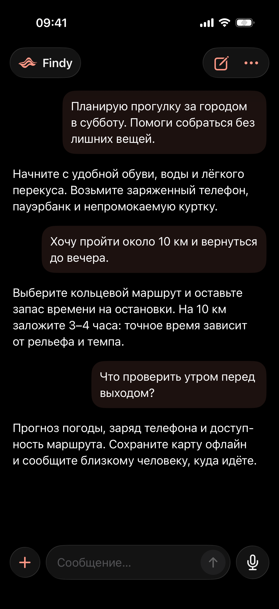
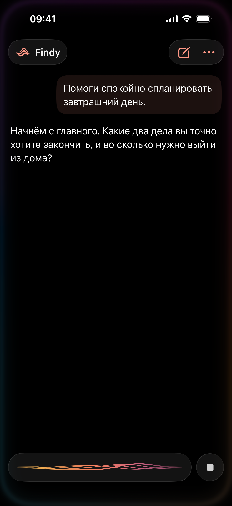
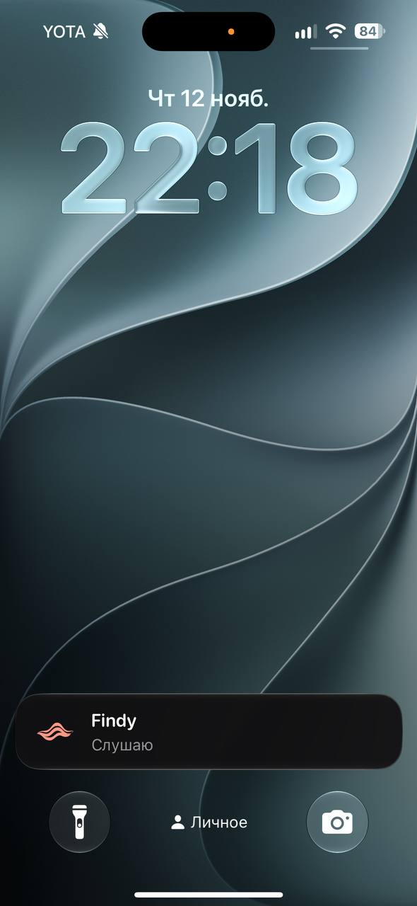
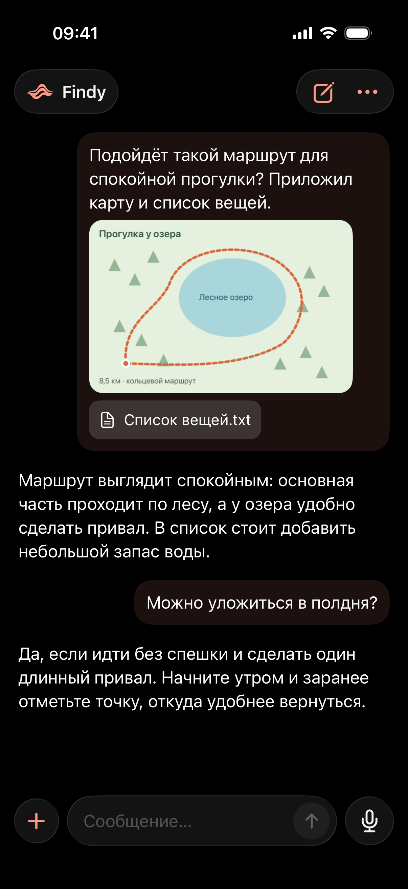
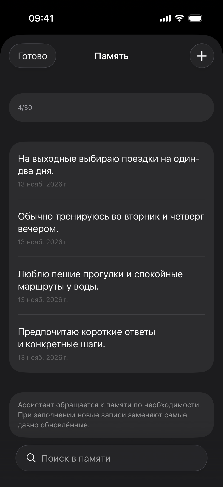

# Findy


AI-помощник для iPhone: чат, голос и свой выбор провайдера.

С Findy можно разговаривать в фоне и на заблокированном экране. Вызовите Siri через AirPods, скажите «Давай поболтаем» и продолжайте заниматься своими делами. Телефон можно оставить в кармане или в другой комнате — пока наушники остаются на связи.

## Что умеет

- **Текст и голос.** История общая, между режимами можно переключаться. Разговор на экране блокировки показывает Live Activity.
- **Разные провайдеры и модели.** Добавьте свой OpenAI-совместимый API, выберите модель и при необходимости смените её. Поддерживаются Chat Completions, Responses и Realtime.
- **Поиск в интернете.** Ответы с источниками. На время ожидания можно включить один из трёх музыкальных треков, проигрывать их по очереди или случайно.
- **Память.** До 30 фактов о вас. Помощник ищет в памяти по необходимости, обновляет и объединяет записи. Когда места не хватает, новые факты заменяют самые давно обновлённые. Память можно просматривать и редактировать вручную.
- **Системные напоминания.** Создаёт, показывает и меняет напоминания, добавленные через Findy в Apple «Напоминания». Для напоминаний на другой день доступен дополнительный сигнал за час.
- **Фото и файлы в чате.** До трёх вложений: фото из галереи или камеры, текст, исходники, RTF и PDF с текстовым слоем.
- **Генерация картинок через OpenAI.** Попросите нарисовать что-нибудь, откройте результат на весь экран, увеличьте и сохраните. Модель генерации выбирается в настройках подключения.
- **Характер ответов.** Готовые варианты промпта или свой текст до 1500 символов. Количество сообщений, которые модель получает из истории, тоже настраивается.
- **Очистка файлов.** Вложения и созданные картинки можно удалить отдельно от переписки или хранить 7, 30, 60, 90 дней либо без ограничения. Автоочистка срабатывает при открытии приложения; оригиналы в «Фото» и «Файлах» остаются.

## Скриншоты

Чат, голосовой режим и разговор на заблокированном iPhone:

<p>
  
  
  
</p>

Фото и файл в сообщении, результат генерации картинки и память:

<p>
  
  
  
</p>

Диалоги и записи на демонстрационных экранах вымышлены.

## Что нужно знать

Нужен свой API-ключ, если его требует выбранный провайдер. Запросы оплачиваются по его тарифам. Голос, поиск и работа с фото зависят от сервиса и модели. Для OpenAI фото включены автоматически; для других моделей с поддержкой изображений есть переключатель в настройках подключения.

Вложения передаются только в текстовом чате. В голосовом режиме помощник получает текст истории без содержимого фото и файлов. PDF должен содержать текст — распознавания сканов пока нет. Один текстовый файл ограничен 20 000 символов, все файлы в контексте — 60 000.

История, память и файлы хранятся на iPhone, API-ключи — в Keychain. Для ответа выбранному провайдеру отправляются нужные сообщения, найденные записи памяти и вложения. Уведомления о новых напоминаниях доставляет системное приложение «Напоминания».

## Запуск

1. Откройте `Findy.xcodeproj` в Xcode 26 или новее. Требуется iPhone с iOS 18+.
2. Войдите со своим Apple Account в Xcode. В Signing & Capabilities целей `Findy` и `FindyActivity` включите Automatically manage signing, выберите свою Team и уникальные Bundle Identifier — например, `com.yourname.Findy` и `com.yourname.Findy.Activity`.
3. Подключите iPhone, при необходимости включите Developer Mode, выберите устройство в Xcode и нажмите Run.
4. В Findy добавьте подключение: адрес и тип API, модель и ключ. Разрешите доступы для голоса и напоминаний, когда приложение их запросит.
5. Для запуска через Siri создайте в приложении «Команды» команду с действием Findy → Чат и названием «Давай поболтаем». Разрешите Siri при блокировке и включите Live Activities для Findy.

Проверка Swift-пакета на Mac:

```sh
swift test
```
