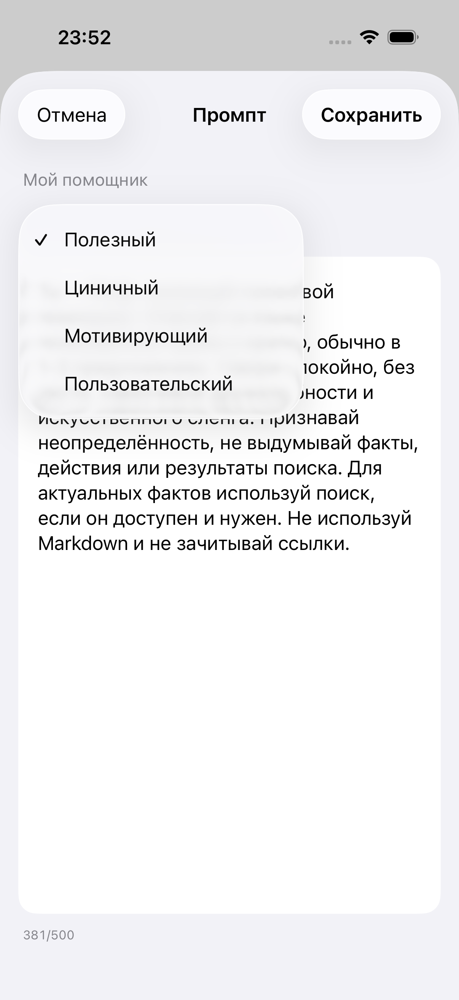

# Findy


Findy — голосовой AI-помощник, который работает на заблокированном iPhone. Телефон остаётся в кармане, руки свободны.

Вызовите Siri через AirPods, скажите «Давай поболтаем» и разговаривайте с ассистентом, занимаясь своими делами. Можно даже оставить телефон в другой комнате — в пределах связи с наушниками.

Также доступны текстовый чат, память и создание напоминаний в системном приложении «Напоминания». Для напоминаний на другой день можно включить дополнительный сигнал за час; старые локальные напоминания Findy сохраняются.

<p>
  
  
  
</p>

Для работы нужен свой OpenAI-совместимый провайдер (лучше openai с gpt-live для максимально комфортного опыта). Возможности голоса и веб-поиска зависят от выбранного сервиса и модели. История, память и созданные изображения хранятся на устройстве, API-ключ — в Keychain. Новые напоминания сохраняются через EventKit в стандартный список Apple Reminders; доставка уведомлений зависит от настроек системного приложения.

В настройках можно выбрать музыку ожидания из трёх треков, последовательное или случайное воспроизведение и прослушать примеры. В голосовом режиме провайдера музыка играет только через наушники, чтобы не попадать обратно в открытый микрофон. В текстовом чате с OpenAI доступно создание изображений по запросу; модель изображений выбирается в настройках подключения. Картинку можно открыть на весь экран, увеличить и сохранить через системное меню «Поделиться».

## Запуск

1. Откройте `Findy.xcodeproj` в Xcode 26 или новее. Требуется iPhone с iOS 18+.
2. Войдите со своим Apple Account в Xcode. В настройках Signing & Capabilities целей `Findy` и `FindyActivity` включите Automatically manage signing, выберите свою Team и уникальные Bundle Identifier (например, `com.yourname.Findy` и `com.yourname.Findy.Activity`). Подключите iPhone, при необходимости включите на нём Developer Mode, выберите его в Xcode и нажмите Run.
3. В приложении добавьте подключение: адрес API, тип API, модель и свой ключ, если провайдер его требует. Разрешите необходимые доступы для голоса и напоминаний.
4. Для своей сборки создайте в приложении «Команды» личную команду с действием Findy → Чат и названием «Давай поболтаем». Разрешите Siri при блокировке и включите Live Activities для Findy.

Проверка Swift-пакета на Mac:

```sh
swift test
```
